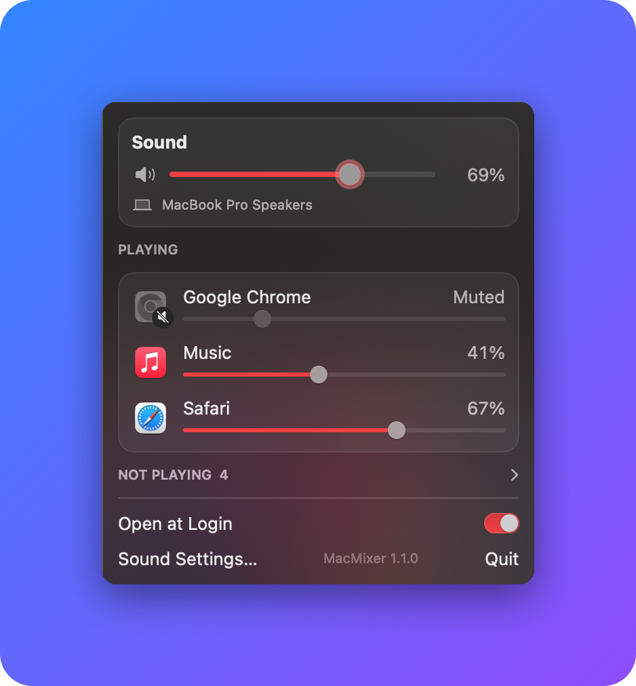

# MacMixer

A per-app volume mixer for your Mac's menu bar. Turn Spotify down to 40%, keep
Chrome at 100%, mute Discord: each app gets its own slider, like the Windows
Volume Mixer.


<!-- Screenshot placeholder: add docs/screenshot.png -->

## Features

- **Live app list.** Shows every app that's making sound, updating as apps
  start and stop. Apps that use audio but are quiet sit under "Not playing".
- **Per-app volume and mute.** A slider for each app (0–100%). Click an app's
  icon to mute it.
- **Master volume.** A Sound card for your current output device, which
  follows the volume keys and Control Center.
- **Remembers your settings.** An app you turned down comes back at the same
  level the next time it plays, even after a restart.
- **Follows your output device.** Switch to AirPods, headphones or a Bluetooth
  speaker, and every app keeps its volume.
- **Open at Login** switch in the panel.
- No kernel extensions, virtual audio drivers or helper apps. It uses Apple's
  own Core Audio process taps.

## Requirements

- macOS 14.2 (Sonoma) or newer
- Apple silicon or Intel Mac

## Install

1. Download `MacMixer-1.0.0.zip` and double-click it to unzip.
2. Drag **MacMixer.app** into your **Applications** folder.
3. Open it. This build isn't signed with an Apple Developer ID, so the first
   time macOS may say it can't verify the developer. **Right-click
   MacMixer.app → Open → Open.** (Or open System Settings → Privacy & Security
   and click **Open Anyway**.) You only need to do this once.
4. MacMixer has no Dock icon. Look for the sliders icon in the menu bar.

To start it automatically, turn on **Open at Login** at the bottom of the panel.

## The "System Audio Recording" permission

The first time you change an app's volume, macOS asks whether MacMixer may
record system audio. Click **Allow**. MacMixer needs it to change an app's
volume: it takes that app's sound, adjusts it, and plays it back. Nothing is
recorded, saved or sent anywhere.

If you clicked Don't Allow, turn it back on in **System Settings → Privacy &
Security**, in the system audio recording section (its exact name varies a
little between macOS versions), by switching MacMixer on.

## How it works

For each app you turn down, MacMixer creates a Core Audio *process tap* that
captures that app's sound and silences the original, plus a private
*aggregate device* that plays the captured sound to your speakers with the
volume applied. Apps at 100% are left completely untouched. When you quit
MacMixer, every tap is removed and apps go straight back to normal.

## Build from source

1. Install Xcode 16 or newer.
2. Open `MacMixer.xcodeproj` and press **Run**, or from Terminal:

   ```sh
   scripts/build-release.sh            # Release build, zipped into releases/
   scripts/build-release.sh --install  # ...and install into /Applications
   ```

   Builds go to `~/Library/Developer/Xcode/DerivedData/MacMixer`. If this
   folder is in iCloud Drive (for example in Documents), don't build inside it:
   iCloud adds file attributes that make code signing fail.
3. `scripts/make-icon.swift` redraws the app icon.

## Known limitations

- **First moments of a muted app.** An app is only tapped once it actually
  starts playing, so the first few milliseconds of sound from a muted or
  turned-down app can slip through.
- **No boost.** Volume goes up to 100%; boosting above that isn't supported
  yet.
- **One output for everything.** Every app plays to the current output
  device; you can't send apps to different devices yet.
- **Apps without a bundle ID** (rare background processes) aren't remembered
  between launches.
- **Sample-rate changes** on the output device are logged but don't rebuild
  taps. If an app goes quiet after a sample-rate switch, toggling its slider
  rebuilds its tap.
- **Not notarized**, so macOS shows the warning described under Install.

## Credits

Made by Skip. Built with Swift, SwiftUI and Core Audio.

Licensed under the MIT License; see [LICENSE](LICENSE).
