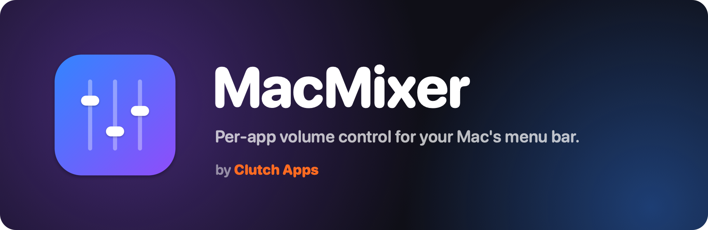

<p align="center">
  
</p>

<p align="center">
  <a href="https://github.com/carlosabufele/MacMixer/releases/latest"></a>
</p>

<p align="center">
  
  
  
  
  
  
</p>

<p align="center">
  <b>
  <a href="#-features">Features</a> •
  <a href="#-install">Install</a> •
  <a href="#-the-system-audio-recording-permission">Permission</a> •
  <a href="#-how-it-works">How it works</a> •
  <a href="#%EF%B8%8F-build-from-source">Build</a> •
  <a href="#-known-limitations">Limitations</a>
  </b>
</p>

<br>

Your Mac has one volume slider. **MacMixer gives every app its own.** Turn Spotify
down to 40%, keep Chrome at 100%, mute Discord, all from a Control Center-style
panel in your menu bar. Think Windows Volume Mixer, but fast, featherweight and
native to macOS.

<!-- Screenshot: add docs/screenshot.png and uncomment the next line.
<p align="center"></p>
-->

## ✨ Features

- 🎚️ **A slider for every app.** Per-app volume from 0–100%. Click an app's icon to mute it.
- ⚡ **Live and snappy.** Apps jump to *Playing* within about half a second of making sound,
  and quiet apps tuck away under *Not playing*.
- 🧠 **Knows which app is which.** Sound from helper processes (Chrome's audio service,
  Safari's web media) shows up under the app it belongs to.
- 🔊 **Master volume, too.** A Sound card for your current output device that stays in sync
  with your volume keys and Control Center.
- 💾 **Remembers everything.** Turn an app down once and it comes back at that level every
  time it plays, even after a restart.
- 🎧 **Follows your output.** Switch to AirPods, headphones or a Bluetooth speaker and every
  app keeps its volume, with no full-volume blip.
- 🪶 **Featherweight.** About 0% CPU when idle and about 13 MB of memory. Apps at 100% are
  left completely untouched.
- 🔐 **No drivers, no kernel extensions.** Built on Apple's own Core Audio process taps.
- 🚀 **Open at Login** switch, right in the panel.

## 📦 Install

> Requires **macOS 14.2 (Sonoma) or newer** on an Apple silicon or Intel Mac.

1. Download **`MacMixer-1.1.0.zip`** from the [latest release](https://github.com/carlosabufele/MacMixer/releases/latest)
   and double-click it to unzip.
2. Drag **MacMixer.app** into your **Applications** folder.
3. Open it. This build isn't notarized by Apple yet, so the first time macOS may block it.
   Go to **System Settings → Privacy & Security**, scroll down, and click **Open Anyway**.
   You only need to do this once.
4. MacMixer has no Dock icon: look for the **sliders icon** in your menu bar.

Turn on **Open at Login** at the bottom of the panel to start it automatically.

## 🔐 The "System Audio Recording" permission

The first time you change an app's volume, macOS asks whether MacMixer may record system
audio. Click **Allow**. MacMixer needs it to change an app's volume: it takes that app's
sound, adjusts it, and plays it straight back. **Nothing is recorded, saved or sent
anywhere.**

Clicked *Don't Allow* by accident? Switch MacMixer back on in **System Settings → Privacy &
Security**, in the system audio recording section (its exact name varies a little between
macOS versions).

## 🛠 How it works

For each app you turn down, MacMixer creates a Core Audio **process tap** that captures
that app's sound and silences the original, plus a private **aggregate device** that plays
the captured sound to your speakers with the volume applied. Apps at 100% are left
completely untouched. Quit MacMixer and every tap is removed instantly, so apps go straight
back to normal.

## 🏗️ Build from source

1. Install **Xcode 16** or newer.
2. Open `MacMixer.xcodeproj` and press **Run**, or from Terminal:

   ```sh
   scripts/build-release.sh            # Release build, zipped into releases/
   scripts/build-release.sh --install  # ...and install into /Applications
   ```

   Builds go to `~/Library/Developer/Xcode/DerivedData/MacMixer`. If your checkout is in
   iCloud Drive (for example in Documents), don't build inside it: iCloud adds file
   attributes that make code signing fail.
3. `scripts/make-icon.swift` redraws the app icon; `scripts/make-banner.swift` redraws the
   banner above.

## 🧩 Known limitations

- **Undocumented macOS call.** To link Safari's (and other web views') sound to the right
  app, MacMixer uses macOS's "responsible process" lookup, which isn't a public API. If a
  future macOS removes it, MacMixer falls back to older checks and that sound may show up
  under a helper's name instead.
- **First moments of a muted app.** An app is only tapped once it actually starts playing,
  so the first few milliseconds of sound from a muted or turned-down app can slip through.
- **No boost yet.** Volume tops out at 100%.
- **One output for everything.** Every app plays to the current output device; per-app
  routing isn't supported yet.
- **Apps without a bundle ID** (rare background processes) aren't remembered between
  launches.
- **Sample-rate changes** on the output device are logged but don't rebuild taps. If an app
  goes quiet after one, nudging its slider rebuilds its tap.
- **Not notarized yet**, hence the one-time *Open Anyway* step.

## 💛 Credits

Made by **Carlos Abufele** at **Clutch Apps**: apps that come in clutch.
Follow along on X: [@Clutch_Apps_](https://x.com/Clutch_Apps_).

Built with Swift, SwiftUI and Core Audio. Licensed under the [MIT License](LICENSE).
